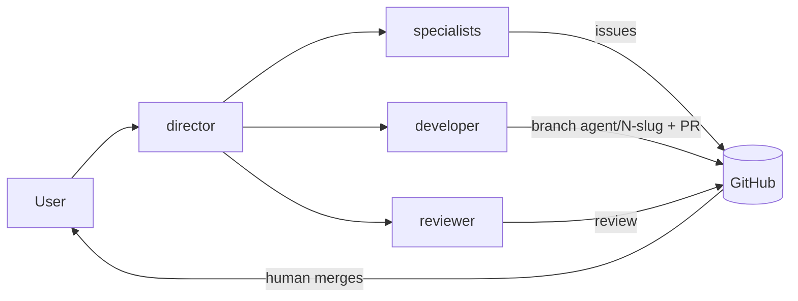

# biuro-ai

A minimal multi-agent "virtual office" harness for [Claude Code](https://code.claude.com/docs/en/overview).

A **director** agent plans the work and delegates it to specialist subagents (product owner, strategist, researcher, marketing, finance, developers, reviewer, translator). Each specialist has its own knowledge folder and its own persistent memory. The agents do real work through GitHub issues and pull requests, inside explicit autonomy limits: they may prepare anything, but a human merges, deploys, publishes and spends money.

*Biuro* is Polish for "office".

This setup has been used to run several real projects (web, mobile, content). This repository is the generic, cleaned-up template: no project data, no memory, no reports.

**Status:** basic version (v0.x). Expect the prompts and permission rules to change.

## How it works



More in [docs/architecture.md](docs/architecture.md).

## Quick start

1. Install [Claude Code](https://code.claude.com/docs/en/setup) and log in.
2. Optional: configure the [GitHub MCP server](https://github.com/github/github-mcp-server) and install the [GitHub CLI](https://cli.github.com/) as a fallback.
3. Create your own copy of this repository, then:

   ```sh
   cd ~/code/office
   claude --agent director
   ```

4. Try: *"Analyse the launch of a new product. Delegate research to researcher, strategy to strategist and the budget to finance. Separate facts from assumptions and save the result in reports/."*

Details: [docs/getting-started.md](docs/getting-started.md).

## Agents

| Agent | Role | Shell | GitHub |
|---|---|---|---|
| `director` | plans, delegates (`Agent(...)`), merges results, weekly review | no | read, issues |
| `product-owner` | issues, backlog, priorities, done criteria | no | read, issues |
| `strategist` | goals, options, risks, metrics | no | no |
| `researcher` | sources, verification, market analysis | no | no |
| `marketing` | communication, content drafts, campaigns | no | no |
| `finance` | costs, budgets, forecasts | no | no |
| `developer` | new projects, cross-repository work | yes | branches, PRs |
| `developer-example` | template for a per-project developer | yes | branches, PRs |
| `reviewer` | PR review, report review, fact-checking | no | reviews |
| `translator` | translations and translation review | no | no |

All agents reply in the user's language. Code, commits, issues and PRs are in English.

## Repository layout

```
CLAUDE.md                  shared rules for all agents
SECURITY.md                threat model and what really protects you
.claude/settings.json      permissions (deny / allow / ask) and env
.claude/agents/            one file per agent
knowledge/<agent>/         curated input you maintain
reports/                   results you keep (git-ignored except README)
docs/                      how it works and how to extend it
examples/                  a sample task and a sample report (fictional)
.github/                   issue and PR templates, labels, gitleaks workflow
```

## Docs

- [Getting started](docs/getting-started.md)
- [Architecture](docs/architecture.md)
- [Adding an agent](docs/adding-an-agent.md)
- [Autonomy and permissions](docs/autonomy-and-permissions.md)
- [Memory](docs/memory.md)
- [Lessons learned](docs/lessons-learned.md)

## Safety in one paragraph

The permission rules in `.claude/settings.json` block merging, force pushes, pushes to `main`, releases, publishing and reading `.env` files, and ask before installing anything. They are a guardrail, not a sandbox: shell rules can be bypassed. Protect your default branch on GitHub, give agents least-privilege tokens and review every PR. Read [SECURITY.md](SECURITY.md) before you let agents work on real repositories.

## License

[MIT](LICENSE)
