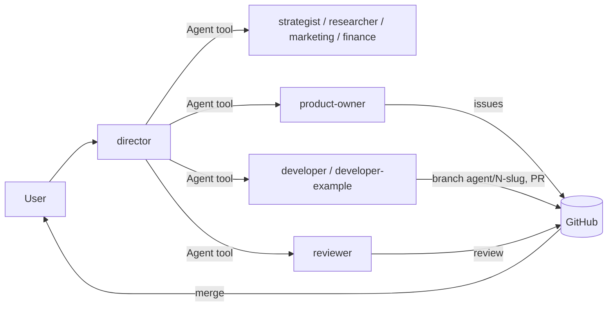

# Architecture

## Building blocks

| Piece | Where | Purpose |
|---|---|---|
| Shared rules | `CLAUDE.md` | loaded for every agent: language, honesty, autonomy limits |
| Agents | `.claude/agents/*.md` | one Markdown file per agent: front matter (`name`, `description`, `tools`, `memory`) and the system prompt |
| Knowledge | `knowledge/<agent-name>/` | curated input written by you |
| Memory | `.claude/agent-memory/<agent-name>/` | durable notes written by the agent (`memory: project`) |
| Reports | `reports/` | results you want to keep |
| Permissions | `.claude/settings.json` | deny / allow / ask rules and environment |
| GitHub conventions | `.github/` | issue and PR templates, labels, secret scanning |

## Flow

1. The user talks to the `director` (`claude --agent director`).
2. The director picks the specialists and calls them with the Agent tool. Each subagent runs in its own context and returns a result.
3. For project work, `product-owner` writes issues; a developer creates a branch `agent/<issue-number>-<slug>`, commits, pushes only that branch and opens a PR.
4. `reviewer` reviews the PR against the issue's done criteria.
5. Only the user merges, deploys and releases.

## Delegation details

- `tools: Agent(a, b, ...)` in `director.md` limits which subagents the director can start. This restriction applies only when the director runs as the main thread (`claude --agent director`). Subagents cannot start further subagents.
- `CLAUDE_CODE_FORK_SUBAGENT=0` in `.claude/settings.json` turns off forked subagents, so the director waits for each specialist's result instead of continuing on its own. JSON has no comments, which is why this is documented here.
- Several developers can work at the same time on different repositories. In the same repository use separate `git worktree` directories so agents do not switch branches under each other.

## Developers per project

`developer` is a generalist for new projects and cross-repository work. A project with regular work gets its own developer (see `developer-example.md`) that knows the repository, its checks and its rules. The director routes issues by repository. See `docs/adding-an-agent.md`.
